---
hide:
  - navigation
  - toc
---

The data engineering behind GATI's labour-market dashboards — how a raw scrape of German job postings becomes classified, translated, dashboard-ready intelligence on skills mobility from India.

Global Access to Talent from India

<a class="primary" href="overview/pipeline-overview/">Explore the pipeline →</a>
<a class="ghost" href="https://draft-version-german-demand-dashboa.vercel.app/" target="_blank">Live dashboard</a>

## What this documents

Every GATI sector dashboard — hospitality, logistics, construction, healthcare — is built from the same repeatable pipeline. This site documents that pipeline end to end, using the **construction** corridor as the worked example, from the raw StepStone scrape all the way to the CSV that lands in the dashboard's country folder.

The pipeline runs in **three stages**, each in a different environment chosen for what it does best:

1

### Clean & Classify
Raw postings are cleaned and each job is classified to a 4-digit **ISCO-08** occupation code using a deterministic German lexicon backed by an AI fallback.
Google Colab · CPU

2

### Translate & Reshape
German text is machine-translated to English on a GPU, occupation codes are spot-checked, and the data is reshaped into the strict 23-column dashboard schema.
Kaggle · GPU T4×2

3

### Employer Sectors
Employers are classified to **ISIC Rev.4** industry codes in an in-dashboard tool, producing the final CSV that the dashboard reads.
React / JSX Artifact

## The journey of one dataset

Input
<h4>Raw scrape</h4>

stepstone_construction.csv

Stage 1 · Colab
<h4>ISCO-08 classified</h4>

construction_classified.csv

Stage 2 · Kaggle
<h4>Translated + reshaped</h4>

construction_final.csv

Stage 3 · JSX
<h4>ISIC employer sectors</h4>

construction.csv

Output
<h4>Live dashboard</h4>

data/germany/construction.csv

## Design principles

The whole pipeline is built around a few non-negotiable rules that keep the data trustworthy:

- **Official codes only.** Every ISCO-08 and ISIC Rev.4 code is validated against the official ILO / UN reference tables. An invented or hallucinated code can never survive a run — integrity checks abort the export if one does.
- **Classify the work, not the employer.** A salesperson in a bakery is a shop assistant, not a baker. Occupation classification reflects the actual job described in the ad.
- **Deterministic first, AI second.** Rule-based classification handles the bulk of rows with zero API cost and full reproducibility; an AI model only sees the residual it genuinely can't resolve — and even then, constrained to the official code list.
- **Every stage is checkpointed.** Long runs save progress so a disconnect never loses work; re-running resumes where it stopped.

!!! tip "New to the project?"
    Start with [The Full Pipeline](overview/pipeline-overview.md) for the bird's-eye view, then follow the three stage guides in order. The [Data Schema](overview/schema.md) page is the reference for what every column means.

---

<small>GATI operates under The Convergence Foundation. This documentation describes the data engineering behind its German-corridor labour-market dashboards.</small>
