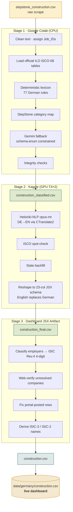

# The Full Pipeline

This page is the map. It shows how a raw scrape becomes a dashboard-ready dataset, why each stage lives where it does, and what artefact leaves each stage.

## Why three environments?

Each stage runs where its work is cheapest and most reliable:

| Stage | Environment | Why there |
|-------|-------------|-----------|
| 1 · Clean & Classify | **Google Colab** (CPU) | Free, persistent Google Drive for the raw data and ISCO reference tables; no GPU needed for rule-based classification. |
| 2 · Translate & Reshape | **Kaggle** (GPU T4×2) | Free GPU hours make neural machine translation of ~15,000 rows fast; the heavy lifting is the translation model. |
| 3 · Employer Sectors | **In-dashboard JSX artifact** | Runs the ISIC classifier interactively with a built-in AI endpoint and no API key to manage; outputs the exact schema the dashboard reads. |

## End-to-end flow

## The two classification systems

Every posting gets classified on **two independent axes**. Keeping them separate is what lets the dashboard answer both "what work is in demand?" and "who is hiring?"

=== "Occupation — ISCO-08"

    **What the person does.** Assigned in Stage 1 from the job title and description.

    - International Standard Classification of Occupations, 2008 revision (ILO).
    - Four hierarchical levels; GATI classifies to the **4-digit unit group** and derives the 3- and 2-digit parents.
    - Example: `7112` Bricklayers → `711` Building frame trades → `71` Building trades workers.

=== "Employer sector — ISIC Rev.4"

    **What industry the employer is in.** Assigned in Stage 3 from the company name and ad context.

    - International Standard Industrial Classification of All Economic Activities, Rev.4 (UN).
    - GATI classifies to the **4-digit class** and derives the 3- and 2-digit parents; the dashboard displays the **2-digit division**.
    - Example: `4120` Construction of buildings → `412` → `41` Construction of buildings.

!!! note "Why both?"
    A bricklayer (ISCO 7112) might be employed by a construction firm (ISIC 41), a staffing agency (ISIC 78), or a facilities-management company (ISIC 81). The occupation stays the same; the employer sector varies. Separating them reveals how demand actually flows through the labour market.

## What leaves each stage

After Stage 1
<h4>ISCO-08 codes added</h4>

construction_classified.csv

German text, occupation codes, source & confidence columns.

After Stage 2
<h4>English + 23-col schema</h4>

construction_final.csv

English content, ISCO names, clean states, dashboard schema.

After Stage 3
<h4>ISIC employer sectors</h4>

construction.csv

Employer_Category + ISIC codes + confidence. Ready to deploy.

Continue to **[Stage 1 · Clean & Classify](../pipeline/stage1-colab.md)** to see the code.
